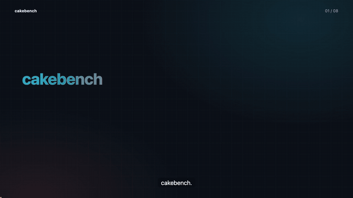
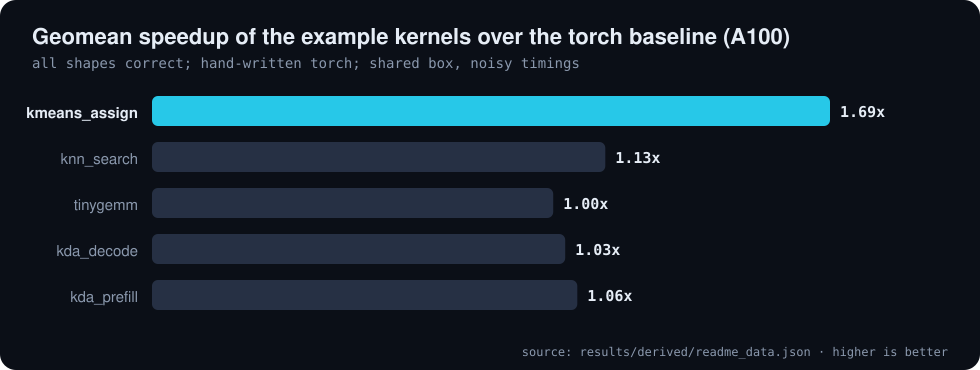
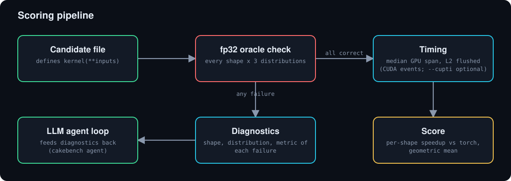

<div align="center">



# 🎂 cakebench

**A kernel benchmark modelled on CAKE (arXiv 2608.12629): correctness against an fp32 oracle first, then speedup over a torch baseline**

     [](https://github.com/Bobliuuu/cakebench/releases/tag/v0.1.0) [](https://huggingface.co/datasets/Bobliu/cakebench)

[🎬 Video](#video) · [📊 Results](#results) · [🧩 How it works](#how-it-works) · [🚀 Use](#use) · [⚠️ Caveats](#caveats) · [🗺️ Repo map](#repo-map)

</div>

---

**Explainer video (voice-over and subtitles): what cakebench measures, how scoring works, and what has and has not been measured**

[](video/cakebench_explainer.mp4)

<a id="video"></a>
cakebench scores a candidate kernel (hand-written or LLM-generated) on kernel families from the **CAKE: Compiler-Agent Co-Design for Frontier Kernel Evolution** paper.
A candidate must be **correct everywhere before it earns any score**; then its per-shape speedup over a torch baseline is aggregated with a geometric mean.
The repo also contains an agent loop that feeds localized failure diagnostics back to an LLM.

<a id="results"></a>

## 📊 Results

The harness is exercised with the five hand-written example kernels in `examples/`. Recorded A100 scores are in `results/a100_example_status.json`; task and shape counts come from the task registry (`tools/readme_data.py`).

| Kernel families | GPU shapes | kmeans_assign | Suite geomean |
|:---:|:---:|:---:|:---:|
| **5** | **21** | **1.69x** | **1.16x** |

**Example kernels (hand-written torch) on one shared A100-SXM4-40GB, full shape portfolio**

| Task | Paper analogue | Correct shapes | Geomean vs torch baseline |
| :--- | :--- | ---: | ---: |
| **kmeans_assign** | **K-Means assignment: nearest centroid (L2) per point. Paper: Flash-KMeans assign, B200.** | **3/3** | **1.69x** |
| knn_search | Exact k-NN search; recall must be ~1.0 and indices unique. Paper: dispatcher portfolio. | 3/3 | 1.13x |
| tinygemm | Small-M GEMM  y = x @ w.T. Paper: TinyGEMM, 35 decode shapes. | 8/8 | 1.00x |
| kda_decode | Kimi Delta Attention single-step decode with per-channel decay (gated delta rule). | 4/4 | 1.03x |
| kda_prefill | Kimi Delta Attention prefill over T tokens from cached state (sequential delta-rule oracle). | 3/3 | 1.06x |

<sub>Source: `results/derived/readme_data.json`</sub>

<p align="center"></p>

<p align="center"></p>

<sub>1.16x is the geometric mean over the five example kernels; the timing box was shared, so absolute numbers are noisy.</sub>

<a id="how-it-works"></a>

## 🧩 How it works

- **Candidate** = a file defining `kernel(**inputs)`, checked against an fp32 oracle over every shape x 3 input distributions (normal / heavy-tailed / tiny).
- **Timing**: median GPU span, L2 flushed before each sample (CUDA events; `--cupti` for a torch.profiler CUPTI span).
- **Score**: per-shape speedup over a torch baseline; geometric mean over the portfolio. Incorrect anywhere => no score.
- **Failures** return localized diagnostics (shape, distribution, metric) that the agent loop feeds back to the LLM.

<p align="center"></p>

<details>
<summary>Kernel families and their paper analogues</summary>

| task | paper analogue |
|---|---|
| `kmeans_assign` | Flash-KMeans assign (B=32,N=65536,K=1024,D=128) |
| `knn_search` | KNN dispatcher portfolio (recall must be ~1.0) |
| `tinygemm` | small-M BF16 GEMM, 12 decode shapes |
| `kda_decode` | Kimi Delta Attention decode |
| `kda_prefill` | Kimi Delta Attention prefill from cached state |

</details>

<a id="use"></a>

## 🚀 Use

```bash
pip install -e .[test]
cakebench list
cakebench run kmeans_assign examples/kmeans_assign.py     # small shapes on CPU, full on GPU with --full
cakebench suite --device cuda --full                       # all examples/
export OPENROUTER_API_KEY=...                              # only for the agent loop
cakebench agent tinygemm --model anthropic/claude-sonnet-4.5 --rounds 6 --device cuda --full
pytest
```

<a id="caveats"></a>

## ⚠️ Caveats

- The Cake IR / compiler is not public, so this benches *kernels*, not the compiler. Baselines are torch, not the paper's FlashML / FlashKDA / FlashInfer.
- Paper numbers are B200; only a shared A100 was used here, so timings are noisy. The CUPTI path is untested.
- The example speedups come from hand-written torch kernels that exercise the harness; they are not results for LLM-written kernels, and none are reported here.

<a id="repo-map"></a>

## 🗺️ Repo map

| Path | What |
|---|---|
| `cakebench/tasks.py` | task registry: shapes, inputs, fp32 oracle, check, baseline |
| `cakebench/harness.py`, `timing.py` | correctness gate and timing |
| `cakebench/agent.py` | LLM agent loop via OpenRouter |
| `examples/` | hand-written example kernels, one per task |
| `results/` | recorded A100 example scores and the derived README data |
| `tests/` | pytest suite |

---

<div align="center"><sub>Generated with [video-readme-maker](https://github.com/Bobliuuu/video-readme-maker). Earlier README kept at docs/readme/previous_README.md.</sub></div>
